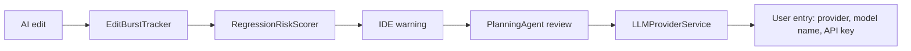
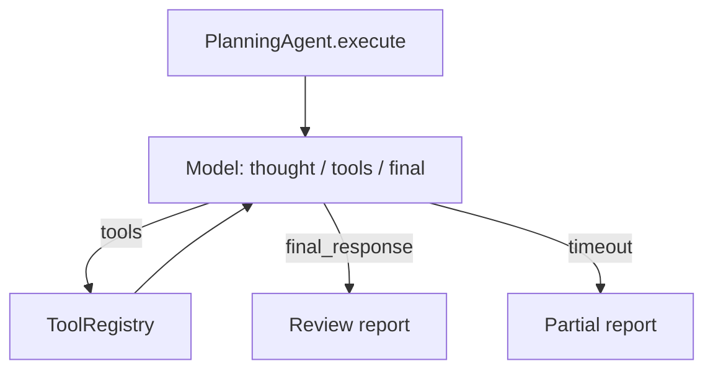
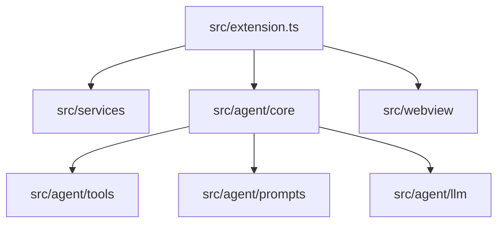

# Architecture

Samurai Agent is an in-IDE guardrail for AI-generated JavaScript and TypeScript. This document mirrors the [architecture section on the site](https://suzuking1192.github.io/samurai-agent-vscode/#architecture) so contributors can edit diagrams in pull requests.

## Product flow

## 1. Edit-time detection (no LLM)

`EditBurstTracker` watches `onDidChangeTextDocument` and a filesystem watcher (CLI tools such as Claude Code write straight to disk). `RegressionRiskScorer` scores the diff with JS/TS patterns, paths, and scope. No model call. `RegressionNotificationService` shows the IDE warning.

- `src/services/EditBurstTracker.ts`
- `src/services/RegressionRiskScorer.ts`
- `src/services/RegressionNotificationService.ts`

## 2. Context the review receives

The review starts with the unified diff, risk signals, and plan files discovered by `AIToolPlanDiscovery` (Cursor, Claude Code, Windsurf, Antigravity).

- `src/services/AIToolPlanDiscovery.ts`

## 3. The review loop

`PlanningAgent.execute` repeats until a final report or timeout: the model returns a thought, tool calls, or a final response. `RuleSelector` chooses prompts. `ToolRegistry` runs tools and feeds results back into the loop.

- `src/agent/core/PlanningAgent.ts`
- `src/agent/core/RuleSelector.ts`
- `src/agent/tools/ToolRegistry.ts`

## 4. Tools the agent can call

Grouped under `src/agent/tools/engine/`: codebase search, git diff/history, LSP diagnostics, static analysis, graph context, sandboxed file reads, Node runtime inspection. Original project files are never modified.

## 5. Debugging path

Separate from edit-time regression review. Epicenter search, hypothesis generation, runtime analysis, and the root-cause report live under `src/agent/tools/debugging/` and `src/agent/prompts/debugging/`.

## 6. Model call (bring your own key)

There is no built-in model catalog. Users add entries: provider (`openai` | `google` | `anthropic`), a model name they type, and an API key stored in VS Code Secret Storage.

- `src/agent/llm/llmProviderService.ts`
- `src/agent/llm/openaiChatClient.ts`
- `src/agent/llm/geminiChatClient.ts`
- `src/agent/llm/anthropicChatClient.ts`
- `src/common/utils/llmSecretStore.ts`
- `src/common/utils/llmEntries.ts`

## 7. Where to contribute

| Change | Start here |
|--------|------------|
| JS/TS risk pattern | `src/services/RegressionRiskScorer.ts`, `src/agent/tools/analysis/` |
| Review prompt or rule | `src/agent/core/RuleSelector.ts`, `src/agent/prompts/` |
| New provider protocol | New client in `src/agent/llm/` + add-model form choice |

Do not start by refactoring `PlanningAgent` unless your change requires it. Prefer the extension points above.
